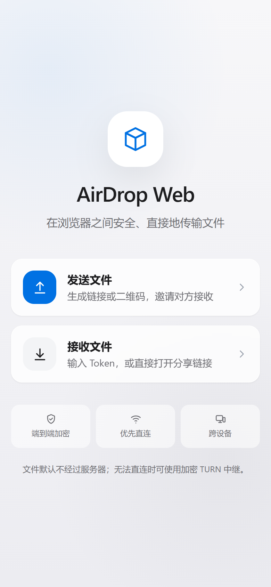
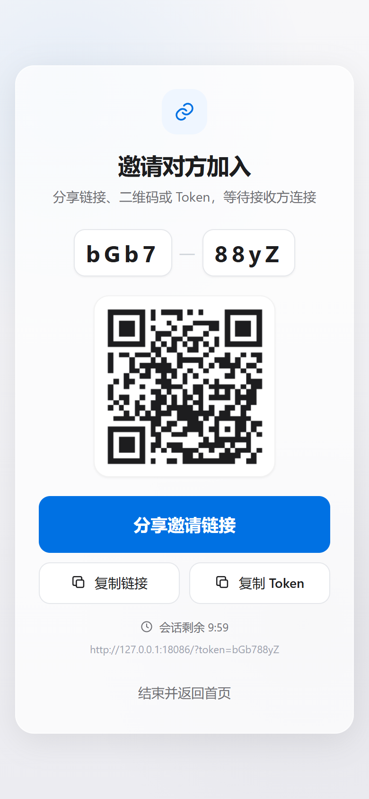
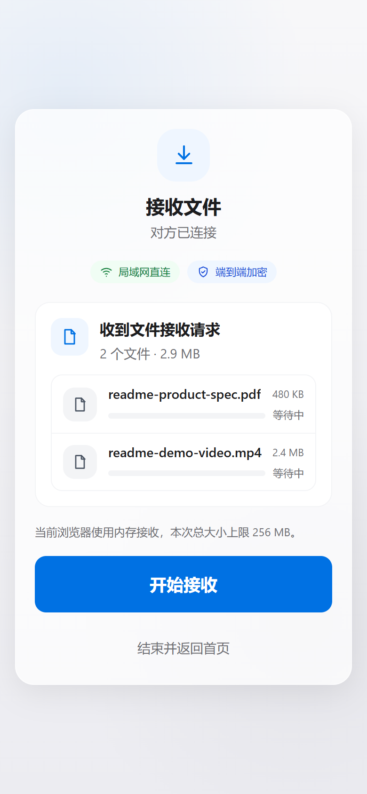
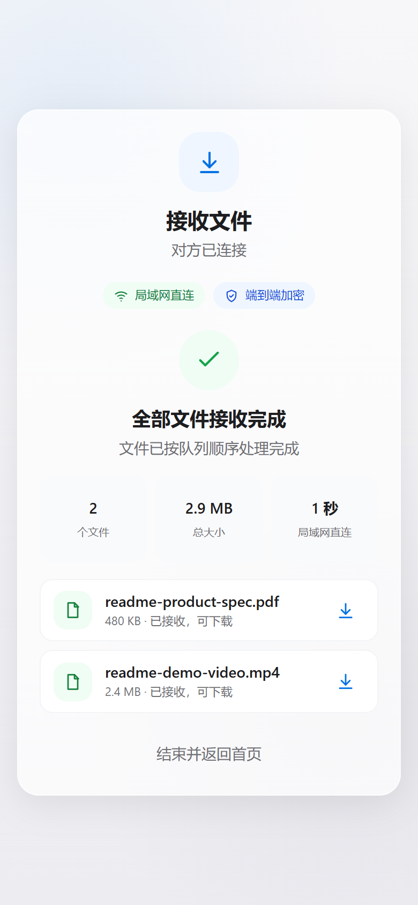

<h1 align="center">AirDrop Web</h1>

<p align="center">
  基于 WebRTC 的浏览器文件传输工具。扫码或分享链接配对，文件优先在两台设备间直连；复杂网络下可回退到加密 TURN 中继。
</p>

<p align="center">
  <a href="https://github.com/0cch/AirDropWeb/actions/workflows/ci.yml"></a>
  
  
  
  
</p>

---

## 产品预览

<table>
  <tr>
    <td align="center" width="50%">
      <br />
      <sub><b>简洁的双入口首页</b><br />发送文件或接收文件，无需注册和安装。</sub>
    </td>
    <td align="center" width="50%">
      <br />
      <sub><b>链接、Token 和二维码配对</b><br />接收方可直接打开分享链接或扫码加入。</sub>
    </td>
  </tr>
  <tr>
    <td align="center" width="50%">
      <br />
      <sub><b>一次确认整批文件</b><br />显示文件级状态、总大小和实际连接路径。</sub>
    </td>
    <td align="center" width="50%">
      <br />
      <sub><b>完成摘要与下载</b><br />展示文件数量、总大小、耗时和连接方式。</sub>
    </td>
  </tr>
</table>

## 功能说明

### 1. 简单配对，无需账户

发送方创建会话后会生成分享链接、8 位 Token 和二维码。接收方可以：

- 扫描二维码打开分享链接
- 直接粘贴 Token 或完整分享链接
- 在支持摄像头的浏览器中使用应用内扫码

分享链接会自动预填 Token，减少手动输入错误。

### 2. WebRTC 点对点传输

文件通过 WebRTC DataChannel 传输，并使用 DTLS 加密。页面会通过 ICE 统计信息显示实际连接路径：

- 局域网直连
- 公网 P2P 直连
- TURN 加密中继
- 连接失败

信令服务器只交换房间信息和 SDP/ICE，不保存文件内容。

### 3. 多文件队列

- 一次选择最多 100 个文件
- 接收方一次确认整个队列
- 按顺序逐个传输
- 显示总进度、文件进度、速度和 ETA
- 支持暂停、继续、取消确认和单文件失败重试
- 同一会话内可继续发送下一批文件

### 4. 大文件与流式落盘

Chromium 浏览器支持 File System Access API：

- 单文件直接写入用户选择的位置
- 多文件可一次选择保存目录
- 文件不会完整驻留在页面内存中

Firefox、Safari 等不支持文件句柄的浏览器会自动使用内存模式，整批文件总大小上限为 256 MB。

### 5. 连接恢复与断点续传

- WebSocket 短暂断开后，默认保留房间 45 秒
- 客户端自动重连并恢复原角色
- DataChannel/ICE 失败后自动重新协商
- 接收端报告已写入偏移，发送端从该位置继续
- 恢复期间显示“正在恢复连接”
- 恢复完成后按字节数校验文件完整性

当前断点续传覆盖同一页面会话内的连接恢复；页面刷新后的持久化恢复属于后续阶段。

### 6. 移动端与可访问性

- 响应式布局和安全区域适配
- 传输期间请求 Screen Wake Lock
- 统一 SVG 图标，减少不同系统 Emoji 差异
- 进度条、错误提示和状态变化提供 ARIA 信息
- 支持系统减少动画设置

## 架构

```text
┌──────────────┐                  ┌────────────────────┐                  ┌──────────────┐
│  发送方浏览器 │ ←── WSS 信令 ──→ │ Node.js 信令服务器 │ ←── WSS 信令 ──→ │ 接收方浏览器 │
└──────┬───────┘                  └────────────────────┘                  └──────┬───────┘
       │                                                                          │
       └──────────────── WebRTC DataChannel（优先直连）────────────────────────────┘
                                      │
                         直连失败时回退到 TURN 中继
```

服务器负责：

- Token 房间与角色管理
- WebSocket 心跳、恢复窗口与速率限制
- SDP/ICE 信令转发
- STUN/TURN ICE 配置下发
- 静态前端文件与健康检查

服务器不接收文件内容。

## 快速开始

要求 Node.js 22 或更高版本。

```bash
git clone https://github.com/0cch/AirDropWeb.git
cd AirDropWeb
npm ci
npm run dev
```

打开 <http://127.0.0.1:5174>。Vite 会将 `/ws` 和 `/api` 代理到本地 `8080` 端口。

常用命令：

```bash
npm run dev              # 启动信令服务器和前端
npm run typecheck        # TypeScript 检查
npm test                 # 前端协议测试 + 服务端回归测试
npm run test:e2e         # Playwright 跨浏览器 E2E
npm run test:e2e:chromium
npm run build            # 生产构建
npm run audit:prod       # 生产依赖审计
npm start                # 启动生产信令服务器
```

首次运行 Playwright：

```bash
npx playwright install chromium firefox webkit
```

## 公网部署

推荐使用 Nginx + HTTPS：

```bash
chmod +x deploy.sh

DOMAIN=example.com \
USE_NGINX=yes \
USE_HTTPS=yes \
./deploy.sh
```

部署脚本会：

- 检查并安装 Node.js 22+
- 安装 workspace 依赖并构建前端
- 配置防火墙
- 可选配置 Nginx、HTTPS 和 WSS
- 创建 systemd 服务
- 应用 systemd 权限收紧配置

Nginx 模式下应用默认只监听 `127.0.0.1`，只需公开 80/443。

## TURN 配置

公网生产环境建议部署自己的 coturn。仓库提供可直接复用的 [coturn Docker Compose 模板](deploy/coturn/README.md)。

使用短期 HMAC 凭据：

```bash
TURN_URLS="turn:turn.example.com:3478?transport=udp,turns:turn.example.com:5349?transport=tcp" \
TURN_SECRET="replace-with-a-long-random-secret" \
TURN_REQUIRED=1 \
DOMAIN=example.com USE_NGINX=yes USE_HTTPS=yes ./deploy.sh
```

详细步骤见 [deploy/coturn/README.md](deploy/coturn/README.md)。

主要环境变量：

| 变量 | 默认值 | 说明 |
| --- | --- | --- |
| `PORT` | `8080` | HTTP/WSS 监听端口 |
| `HOST` | `0.0.0.0` | 监听地址；Nginx 模式建议 `127.0.0.1` |
| `ALLOWED_ORIGINS` | 同源 | 额外允许的 WebSocket Origin，逗号分隔 |
| `ROOM_TTL_MS` | `600000` | 未配对房间有效期 |
| `ROOM_RESUME_GRACE_MS` | `45000` | WebSocket 断开后的恢复窗口 |
| `MAX_ROOMS` | `500` | 全局房间上限 |
| `MAX_CLIENTS` | `1000` | WebSocket 连接上限 |
| `STUN_URLS` | 内置公共 STUN | 逗号分隔的 STUN 地址 |
| `TURN_URLS` | 空 | 逗号分隔的 TURN/TURNS 地址 |
| `TURN_SECRET` | 空 | 短期 TURN 凭据共享密钥 |
| `TURN_TTL_SECONDS` | `3600` | 短期 TURN 凭据有效期 |
| `TURN_REQUIRED` | `0` | 为 `1` 时 TURN 配置无效会拒绝启动 |

`/api/ice-config` 会向浏览器下发 STUN/TURN 配置；短期 TURN 密码不会写入静态构建产物。

## 测试

### 单元与回归测试

```bash
npm test
```

覆盖：

- 传输控制消息和文件队列协议
- 文件名校验与分享链接 Token 提取
- 恶意 WebSocket/HTTP 输入
- 信令房间恢复
- TURN 配置校验和短期凭据生成

### Playwright E2E

```bash
npm run test:e2e
```

覆盖 Chromium、Firefox 和 WebKit 的基础传输，并在 Chromium 中执行：

- 多文件内存模式传输
- 多文件目录流式落盘
- 模拟磁盘写入失败
- 信令 WebSocket 断开恢复
- DataChannel 断开后的断点续传
- 恢复后文件字节完整性
- 摄像头权限失败与手动输入降级

GitHub Actions 会执行 Node.js 22/24 构建矩阵和跨浏览器 E2E。

## 安全与隐私

- Token 使用 `crypto.randomInt()` 生成
- 每个角色使用独立不可猜测的 `sessionId` 恢复会话
- WebSocket Origin、连接数、房间数和消息速率限制
- 信令消息执行结构、类型和大小校验
- 静态路径防目录穿越
- CSP、`X-Content-Type-Options`、`X-Frame-Options`、`Referrer-Policy`
- 文件内容不经过信令服务器
- 使用 TURN 时，文件仍由 DTLS 加密，但会经过 TURN 服务器带宽
- 摄像头画面只在本地用于二维码识别，不上传服务器

## 浏览器支持

| 浏览器 | P2P 传输 | 断点续传 | 流式落盘 | 应用内扫码 |
| --- | --- | --- | --- | --- |
| Chrome / Edge | ✅ | ✅ | ✅ | ✅ |
| Firefox | ✅ | ✅ | 内存模式 | 依赖摄像头与安全上下文 |
| Safari | ✅ | ✅ | 内存模式 | 依赖摄像头与安全上下文 |

公共 STUN 可以协助 NAT 穿透，但无法覆盖所有网络。对称 NAT、企业防火墙或 UDP 被限制时，需要配置 TURN。

## 技术栈

- React 19 + TypeScript
- Vite 8
- Tailwind CSS
- WebRTC DataChannel
- Node.js + `ws`
- coturn
- Vitest + Node.js Test Runner
- Playwright
- GitHub Actions

## License

[MIT](LICENSE)
